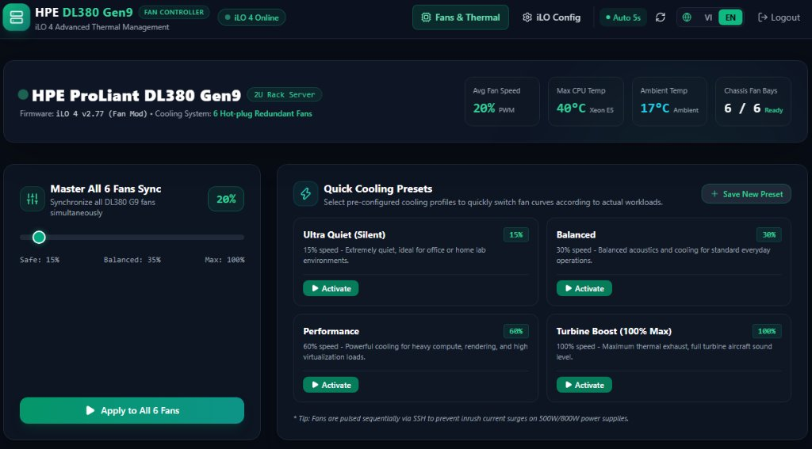
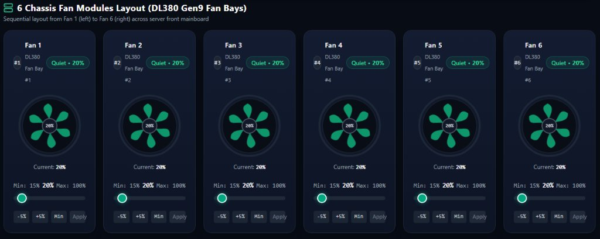
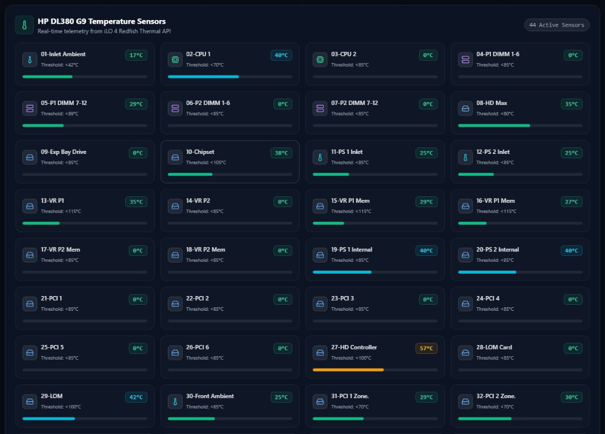
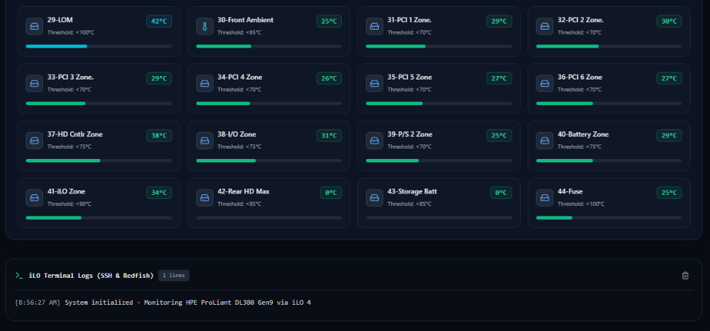
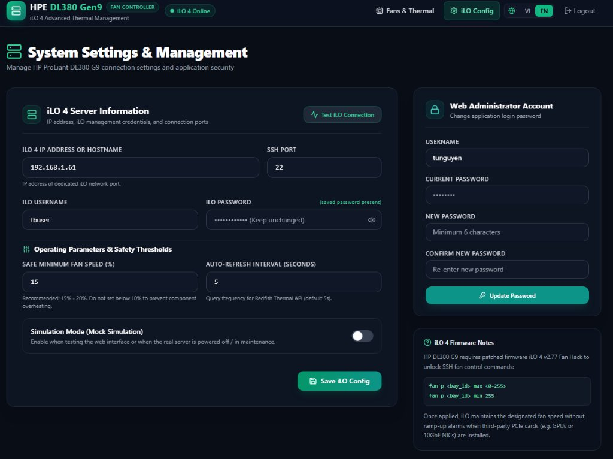

# HPE ProLiant DL380 Gen9 (iLO 4) Fan Controller & Thermal Monitor 🚀

[🇻🇳 Xem bản Tiếng Việt](README.vi.md) | [🇬🇧 English Version](README.md)

[](https://nextjs.org/)
[](https://nodejs.org/)
[](https://www.typescriptlang.org/)
[](https://tailwindcss.com/)
[](https://www.docker.com/)
[](LICENSE)

A modern, responsive web application designed for **HPE ProLiant DL380 Gen9 (and Gen8)** servers running patched **iLO 4** firmware. It provides granular fan speed control via SSH and real-time hardware thermal monitoring via the Redfish REST API.

---

## 📸 Screenshots

| Dashboard Overview & Master Controller | 6-Fan Chassis Control Board |
|:---:|:---:|
|  |  |

| Real-time Redfish Thermal Sensors (44 Sensors) | Live SSH Action Logs & Zone Telemetry |
|:---:|:---:|
|  |  |

| System Settings & iLO 4 Connection |
|:---:|
|  |

---

## ✨ Features

- **Dual-Protocol Hardware Integration:**
  - **SSH (Fan Hack):** Sends raw PWM commands (`fan p <bay_id> max <0-255>`) to control individual fan bays directly.
  - **Redfish REST API:** Telemetry polling for real-time temperatures (CPUs, Ambient/Inlet, Memory, PCIe slots, etc.).
- **Legacy SSH Ciphers & Handshake Compatibility:**
  - Built-in support for iLO 4 legacy key exchange (`diffie-hellman-group14-sha1`, `diffie-hellman-group1-sha1`), ciphers (`aes128-cbc`, `3des-cbc`), and host keys (`ssh-rsa`), resolving connection handshake errors.
- **Bilingual Interface (i18n):**
  - Instant switching between **English (EN)** and **Tiếng Việt (VI)** with zero hydration flash.
  - Dynamically translated action logs.
- **Chassis 6-Fan Control:**
  - Individual fan sliders with immediate preview and spinning tachometer animation.
  - **Master Sync Slider:** Set all 6 fans simultaneously with sequential SSH dispatch to prevent inrush current surges on power supplies.
- **Cooling Profiles (Presets):**
  - **Built-in Presets:** Ultra Quiet (Silent 15%), Balanced (30%), Performance (60%), Turbine Boost (100%).
  - **Custom Presets:** Save and manage custom fan curves directly from the UI.
- **Safety Safeguards:**
  - Configurable minimum safe fan speed (default: 15% - 20%) to prevent hardware damage.
- **Live Terminal Log:**
  - Real-time SSH and REST execution log with color-coded status codes.
- **Mock Simulation Mode:**
  - Built-in simulation mode to test UI and workflows without touching physical server hardware.
- **Responsive Dark Mode UI:**
  - Optimized for desktop, tablet, and mobile devices (< 640px) without horizontal overflow.
- **Zero-Config Persistent Storage:**
  - Embedded SQLite database stored in `/app/data/app.db`. No external database required.

---

## 🛠️ Prerequisites

1. **Hardware:**
   - HPE ProLiant DL380 Gen9 (or compatible Gen8 server) equipped with iLO 4.
2. **Firmware:**
   - Patched iLO 4 firmware unlocking fan speed commands (e.g., [kendallgoto/ilo4_unlock](https://github.com/kendallgoto/ilo4_unlock) v2.77 Fan Hack).
3. **Software:**
   - [Docker](https://docs.docker.com/get-docker/) & [Docker Compose](https://docs.docker.com/compose/install/) (Node.js 22+ & pnpm if building from source).

---

## 🚀 Quick Start (Docker)

You **do not** need to expose passwords or IPs in your compose file. Everything is securely configured via the web interface during first-time setup and persisted into `./data`.

### 1. Using Docker Compose (Recommended)

Create `docker-compose.yml`:

```yaml
services:
  ilo-fan-controller:
    image: ghcr.io/vietnamvps/ilo-fan-controller:latest
    container_name: ilo-fan-controller
    restart: unless-stopped
    ports:
      - "3000:3000"
    volumes:
      - ./data:/app/data
```

> **Note for Linux Host File Permissions:**  
> The container runs as non-root user `node` (`uid: 1000`, `gid: 1000`). If mounting a local directory on Linux, ensure the host directory is writable:  
> ```bash
> mkdir -p ./data && chown -R 1000:1000 ./data
> ```

Start the container:

```bash
docker compose up -d
```

### 2. Using Docker CLI

```bash
docker run -d \
  --name ilo-fan-controller \
  --restart unless-stopped \
  -p 3000:3000 \
  -v $(pwd)/data:/app/data \
  ghcr.io/vietnamvps/ilo-fan-controller:latest
```

---

## 🧭 Initial Setup Wizard

1. Open your browser and navigate to:
   ```text
   http://<YOUR_SERVER_IP>:3000
   ```
2. **First-time Onboarding (`/setup`):**
   - Create your administrator account (Username & Password).
   - Enter your iLO 4 connection details (Dedicated iLO IP, SSH port 22, iLO Username & Password).
   - Click **Complete Setup & Enter Dashboard**.
3. **Settings & Verification (`/settings`):**
   - Click **Test iLO Connection** to verify both Redfish REST API (443) and SSH Fan Hack (22).
   - If Mock Mode is enabled, toggle it OFF once the connection test succeeds.

---

## ⚙️ Environment Variables (Optional)

| Variable | Default | Description |
| :--- | :---: | :--- |
| `PORT` | `3000` | HTTP listening port for the web application. |
| `ILO_ENCRYPTION_KEY` | *(Auto-generated)* | 32-byte hex key for AES-256-GCM encryption of stored iLO passwords. When omitted, an encryption key is generated automatically and saved into `data/.secret_key`. |
| `ILO_REJECT_UNAUTHORIZED` | `false` | Set to `true` to verify SSL certificates on iLO 4 HTTPS requests (keep `false` for default factory self-signed certs). |
| `COOKIE_SECURE` | `auto` | Cookie HTTPS flag: `auto` (auto-detects HTTPS / proxy headers), `true` (enforce HTTPS cookies), or `false` (allow plain HTTP on LAN). |
| `TRUST_PROXY` | `false` | Enable **ONLY** when deployed behind a trusted reverse proxy (Nginx, Caddy, Cloudflare Tunnel). **Security Warning:** Do NOT enable `TRUST_PROXY` if the application is exposed directly to clients without a reverse proxy, as clients could forge `X-Forwarded-For` and `X-Forwarded-Host` headers. |

---

## 🔒 Security Architecture

- **Defense-in-Depth Authentication:** Dual-layer verification with `proxy.ts` request proxy and `requireAuth()` guards on every protected API route. Session tokens use HS256 JWT signed with an auto-generated cryptographic secret.
- **Rate-Limiting Protection:** Maximum 5 failed login attempts per 15-minute window per IP/account, returning HTTP 429 (`Retry-After`).
- **AES-256-GCM Password Encryption:** iLO credentials are encrypted at rest with authenticated AES-256-GCM in SQLite. Passwords are never sent back to the frontend.
  - *Key Storage & Backup Limitation:* The local key is stored in `data/.secret_key` (file mode `0600`). **Important Limitation:** If you back up the entire `./data` directory, the backup contains both the SQLite database (`app.db`) and the encryption key (`.secret_key`). Anyone with read access to the backup can decrypt the stored iLO password. In high-security setups, inject `ILO_ENCRYPTION_KEY` from a separate secret manager (e.g. Docker secrets or CI/CD env).
- **Strict Parameter Validation:** Fan bay indices are strictly validated to integers `0..5`, speeds to `0..100`, and hosts to valid IPv4/hostnames to eliminate command injection risk.
- **CSRF Protection:** State-mutating requests (POST, PUT, PATCH, DELETE) verify `Origin` and `Host` headers. When `TRUST_PROXY=true`, `X-Forwarded-Host` is used.
- **Linux Non-Root Permissions:** The container executes as user `node` (`uid: 1000`, `gid: 1000`). Run `mkdir -p ./data && chown -R 1000:1000 ./data` on the host to grant SQLite write access.
- **Recommended Deployment:** Keep this tool strictly within a private management LAN or isolated management VLAN. Never expose this interface directly to the public internet without an authenticated, HTTPS-enabled reverse proxy and multi-factor authentication (MFA).

---

## ⚠️ Hardware Safety & Warranty Disclaimer

> [!WARNING]
> **PLEASE READ CAREFULLY BEFORE USE:**  
> Manually controlling server fan speeds below factory thresholds or running third-party modified iLO firmware may lead to component overheating, thermal throttling, degraded hardware lifespan, or permanent physical damage if fan curves are misconfigured.  
> This software is provided "as is", without warranty of any kind. You assume full responsibility for monitoring thermal readings and operating your equipment safely. The authors and contributors shall not be held liable for any hardware damage, data loss, or voided manufacturer warranties resulting from the use of this software.

---

## ⚖️ Trademark Disclaimer

> [!NOTE]
> **HPE, ProLiant, and iLO** are registered trademarks of **Hewlett Packard Enterprise Company**.  
> This project is an independent, community-driven open-source utility and is **not affiliated with, endorsed by, certified by, or sponsored by Hewlett Packard Enterprise Company**.

---

## 🤝 Credits & Acknowledgements

- Special thanks to **Kendall Goto** for the open-source firmware research: [`kendallgoto/ilo4_unlock`](https://github.com/kendallgoto/ilo4_unlock).
- Thanks to the homelab community and the *"Silence of the Fans"* enthusiasts for documenting HPE iLO 4 CLI commands.

---

## 📄 License

This project is licensed under the [MIT License](LICENSE).
See [THIRD_PARTY_LICENSES.md](THIRD_PARTY_LICENSES.md) for licenses of third-party libraries.
