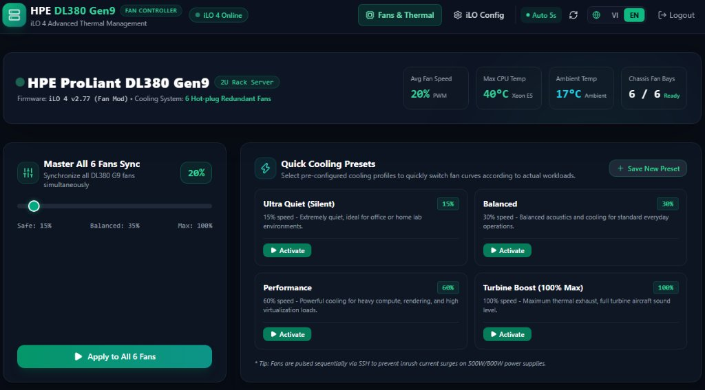
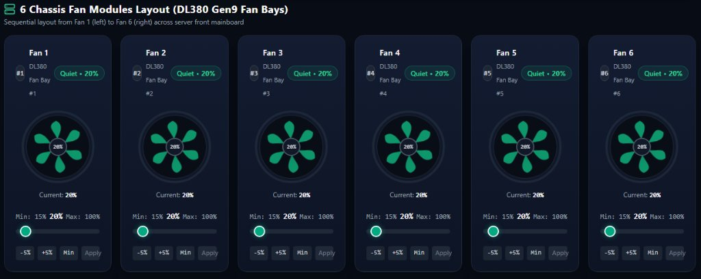
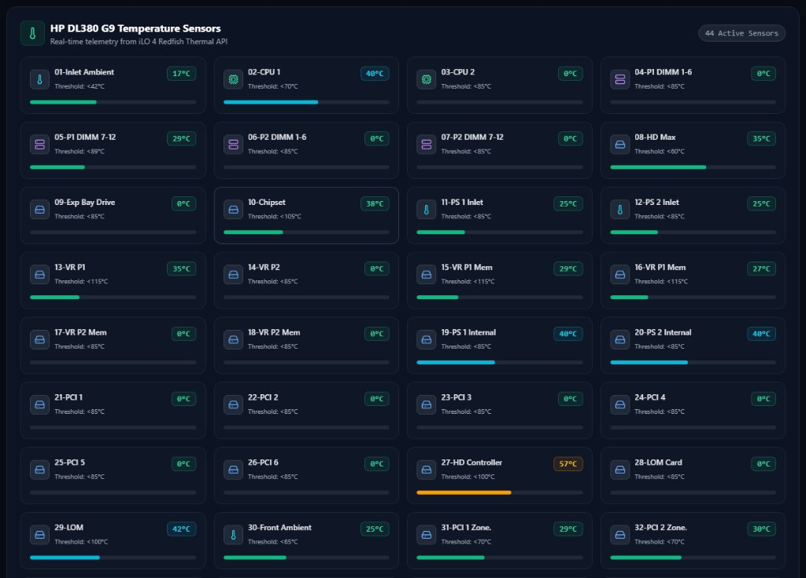
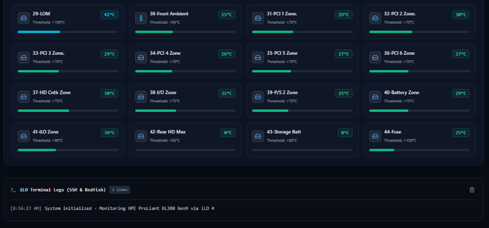
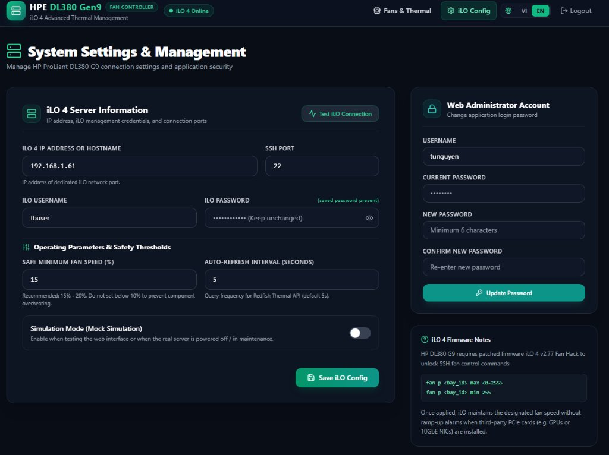

# Bộ Điều Khiển Quạt & Giám Sát Nhiệt Độ HPE ProLiant DL380 Gen9 (iLO 4) 🚀

[🇻🇳 Xem bản Tiếng Việt](README.vi.md) | [🇬🇧 English Version](README.md)

[](https://nextjs.org/)
[](https://nodejs.org/)
[](https://www.typescriptlang.org/)
[](https://tailwindcss.com/)
[](https://www.docker.com/)
[](LICENSE)

Ứng dụng web hiện đại, tối ưu cho dòng máy chủ **HPE ProLiant DL380 Gen9 (và Gen8)** sử dụng firmware **iLO 4** đã mở khóa (patched). Cung cấp khả năng điều khiển chi tiết tốc độ từng cụm quạt qua giao thức SSH và giám sát thông số nhiệt độ phần cứng thời gian thực thông qua Redfish REST API.

---

## 📸 Hình ảnh Giao diện Thực tế

| Tổng quan Dashboard & Thanh Đồng bộ | Bảng Điều khiển 6 Quạt Khung máy |
|:---:|:---:|
|  |  |

| Cảm biến Nhiệt độ Redfish (44 Sensors) | Nhật ký Lệnh SSH & Telemetry |
|:---:|:---:|
|  |  |

| Cấu hình Kết nối iLO 4 & Tài khoản |
|:---:|
|  |

---

## ✨ Tính năng Nổi bật

- **Tích hợp Phần cứng Giao thức Kép:**
  - **SSH (Fan Hack):** Gửi trực tiếp lệnh PWM thô (`fan p <bay_id> max <0-255>`) tới từng quạt.
  - **Redfish REST API:** Đọc cảm biến nhiệt độ theo thời gian thực (CPU, Khí nạp/Inlet, RAM, Khe cắm PCIe, v.v.).
- **Tương thích Thuật toán Mã hóa Cũ của iLO 4:**
  - Hỗ trợ đầy đủ các bộ trao đổi khóa cũ (`diffie-hellman-group14-sha1`, `diffie-hellman-group1-sha1`), cipher (`aes128-cbc`, `3des-cbc`) và host key (`ssh-rsa`), khắc phục triệt để lỗi bắt tay SSH trên iLO 4.
- **Đa ngôn ngữ Song ngữ Anh - Việt (i18n):**
  - Chuyển đổi mượt mà giữa **Tiếng Việt (VI)** và **Tiếng Anh (EN)**, đọc ngôn ngữ từ server cookie tránh nháy trang (zero hydration flash).
- **Điều khiển 6 Quạt Linh hoạt:**
  - Thanh trượt điều chỉnh tốc độ từng quạt kèm hoạt họa cánh quạt quay đồng bộ theo tốc độ thực tế.
  - **Thanh trượt Master Sync:** Đồng bộ cả 6 quạt cùng lúc, phát lệnh tuần tự qua SSH để chống sụt áp nguồn (inrush current).
- **Hồ sơ Làm mát (Presets):**
  - **Cấu hình có sẵn:** Siêu êm (Silent 15%), Cân bằng (30%), Hiệu năng cao (60%), Phản lực cất cánh (Turbine 100%).
  - **Tùy chỉnh cá nhân:** Tạo, lưu và xóa preset quạt trực tiếp trên giao diện.
- **Giới hạn An toàn Phần cứng:**
  - Cho phép cấu hình ngưỡng quạt tối thiểu an toàn (khuyến nghị 15% - 20%) ngăn ngừa quá nhiệt.
- **Khung Nhật ký Trực quan:**
  - Hiển thị phản hồi thực tế từ SSH và Redfish theo thời gian thực.
- **Chế độ Giả lập (Mock Simulation Mode):**
  - Cho phép thử nghiệm toàn bộ giao diện và thao tác mà không cần kết nối tới máy chủ thật.
- **Giao diện Tối (Dark Mode) Responsive:**
  - Tối ưu hiển thị hoàn hảo trên máy tính để bàn, máy tính bảng và điện thoại di động (< 640px).
- **Lưu trữ Cục bộ Không cần Cấu hình:**
  - Sử dụng SQLite nhúng lưu tại `/app/data/app.db`. Không cần cài thêm bất kỳ cơ sở dữ liệu ngoài nào.

---

## 🛠️ Yêu cầu Hệ thống

1. **Phần cứng:**
   - Máy chủ HPE ProLiant DL380 Gen9 (hoặc dòng Gen8 tương thích) có cổng quản trị iLO 4.
2. **Firmware:**
   - Đã cài bản vá mở khóa quạt iLO 4 (ví dụ: [kendallgoto/ilo4_unlock](https://github.com/kendallgoto/ilo4_unlock) v2.77 Fan Hack).
3. **Môi trường:**
   - [Docker](https://docs.docker.com/get-docker/) & [Docker Compose](https://docs.docker.com/compose/install/) (Node.js 22+ & pnpm nếu biên dịch từ nguồn).

---

## 🚀 Triển khai Nhanh với Docker

Bạn **không cần** phải lộ mật khẩu hay địa chỉ IP vào file compose. Toàn bộ thông tin được cấu hình trực quan qua giao diện web lần đầu khởi chạy và lưu vào thư mục `./data`.

### 1. Sử dụng Docker Compose (Khuyến nghị)

Tạo file `docker-compose.yml`:

```yaml
services:
  ilo-fan-controller:
    image: ghcr.io/vietnamvps/ilo-fan-controller:latest
    container_name: ilo-fan-controller
    restart: unless-stopped
    ports:
      - "3000:3000"
    volumes:
      - ./data:/app/data
```

> **Lưu ý phân quyền thư mục trên Linux Host:**  
> Container chạy bằng người dùng không đặc quyền `node` (`uid: 1000`, `gid: 1000`). Nếu mount thư mục trên Linux, hãy chạy lệnh sau trên máy host để cấp quyền ghi cho SQLite:  
> ```bash
> mkdir -p ./data && chown -R 1000:1000 ./data
> ```

Khởi động ứng dụng:

```bash
docker compose up -d
```

### 2. Sử dụng Docker CLI

```bash
docker run -d \
  --name ilo-fan-controller \
  --restart unless-stopped \
  -p 3000:3000 \
  -v $(pwd)/data:/app/data \
  ghcr.io/vietnamvps/ilo-fan-controller:latest
```

---

## 🧭 Hướng dẫn Cài đặt Lần đầu

1. Mở trình duyệt và truy cập:
   ```text
   http://<IP_MÁY_CHỦ>:3000
   ```
2. **Thiết lập Quản trị (`/setup`):**
   - Tạo tài khoản quản trị (Tên đăng nhập & Mật khẩu).
   - Nhập thông tin kết nối iLO 4 (Địa chỉ IP cổng iLO, cổng SSH 22, tài khoản và mật khẩu iLO).
   - Bấm **Hoàn tất Thiết lập & Vào Bảng Điều Khiển**.
3. **Cài đặt & Kiểm tra (`/settings`):**
   - Bấm **Test Kết nối iLO** để kiểm tra đồng thời Redfish REST API (443) và SSH Fan Hack (22).
   - Nếu đang ở chế độ Giả lập (Mock Mode), gạt tắt sau khi test thành công.

---

## ⚙️ Biến Môi trường Tùy chọn (Environment Variables)

| Tên biến | Mặc định | Mô tả |
| :--- | :---: | :--- |
| `PORT` | `3000` | Cổng lắng nghe HTTP của giao diện web. |
| `ILO_ENCRYPTION_KEY` | *(Tự sinh)* | Chuỗi hex 32-byte dùng mã hóa AES-256-GCM cho mật khẩu iLO. Nếu để trống, key tự sinh và lưu vào `data/.secret_key`. |
| `ILO_REJECT_UNAUTHORIZED` | `false` | Đặt `true` nếu muốn bắt buộc kiểm tra chứng chỉ SSL iLO 4 (giữ `false` cho chứng chỉ tự ký mặc định của iLO). |
| `COOKIE_SECURE` | `auto` | Cờ bảo mật cookie HTTPS: `auto` (tự nhận diện qua HTTPS / proxy headers), `true` (ép cookie HTTPS), `false` (cho phép HTTP mạng nội bộ LAN). |
| `TRUST_PROXY` | `false` | Bật `true` **CHỈ KHI** triển khai sau một Reverse Proxy đáng tin cậy (Nginx, Caddy, Cloudflare Tunnel). **Cảnh báo bảo mật:** Tuyệt đối không bật `TRUST_PROXY` nếu ứng dụng mở trực tiếp cho client mà không qua reverse proxy, vì kẻ xấu có thể làm giả header `X-Forwarded-For` và `X-Forwarded-Host`. |

---

## 🔒 Kiến trúc Bảo mật

- **Xác thực Đa tầng:** Bảo vệ 2 lớp kết hợp giữa `proxy.ts` và helper `requireAuth()` ở đầu mọi API quản trị. Token phiên làm việc dùng JWT ký bằng thuật toán HS256 với secret ngẫu nhiên bảo mật.
- **Chống Dò quét Mật khẩu (Rate Limiting):** Khóa tạm thời 15 phút sau 5 lần đăng nhập thất bại theo địa chỉ IP và tài khoản, trả về mã lỗi HTTP 429 (`Retry-After`).
- **Mã hóa Mật khẩu iLO Chuẩn AES-256-GCM:** Mật khẩu iLO được mã hóa trước khi lưu vào SQLite. Mật khẩu không bao giờ được gửi trả về frontend.
  - *Vị trí khóa & Hạn chế cần lưu ý:* Khóa mã hóa lưu tại `data/.secret_key` (quyền hạn `0600`). **Hạn chế quan trọng:** Nếu bạn sao lưu (backup) toàn bộ thư mục `./data`, bản sao lưu sẽ chứa cả database (`app.db`) lẫn khóa bí mật (`.secret_key`), dẫn đến việc ai có bản backup đều có thể giải mã được mật khẩu. Trong môi trường yêu cầu bảo mật cao, hãy truyền `ILO_ENCRYPTION_KEY` từ biến môi trường bên ngoài thay vì dùng file key cục bộ.
- **Xác thực Tham số Nghiêm ngặt:** Giới hạn index quạt trong tập số nguyên `0..5`, tốc độ `0..100` và IP/hostname hợp lệ nhằm ngăn chặn hoàn toàn nguy cơ chèn mã độc vào SSH.
- **Bảo vệ CSRF:** Kiểm tra `Origin` và `Host` (hoặc `X-Forwarded-Host` khi bật `TRUST_PROXY`) trên toàn bộ các request thay đổi dữ liệu (POST, PUT, PATCH, DELETE).
- **Phân quyền Non-Root Linux:** Container chạy dưới user `node` (`uid: 1000`, `gid: 1000`). Chạy lệnh `mkdir -p ./data && chown -R 1000:1000 ./data` trên máy host để cấp quyền ghi cho SQLite.
- **Khuyến cáo Triển khai:** Chỉ nên chạy dịch vụ trong mạng LAN/VLAN quản trị riêng. Nếu mở ra Internet, bắt buộc đặt sau Reverse Proxy có HTTPS và bảo vệ xác thực đa yếu tố (MFA).

---

## ⚠️ Cảnh Báo An Toàn Phần Cứng & Miễn Trừ Trách Nhiệm

> [!WARNING]
> **VUI LÒNG ĐỌC KỸ TRƯỚC KHI SỬ DỤNG:**  
> Việc can thiệp giảm tốc độ quạt của máy chủ xuống thấp hơn mức thiết kế mặc định của nhà sản xuất hoặc nạp firmware mod bên thứ ba có thể gây quá nhiệt linh kiện, tụt hiệu năng (thermal throttling), giảm tuổi thọ phần cứng hoặc gây hỏng hóc vật lý nếu cấu hình không đúng cách.  
> Ứng dụng này được cung cấp "nguyên trạng" (as is) và hoàn toàn không có bảo hành. Bạn hoàn toàn tự chịu trách nhiệm về an toàn thiết bị và giám sát nhiệt độ của hệ thống. Tác giả và những người đóng góp không chịu bất kỳ trách nhiệm pháp lý nào đối với hỏng hóc phần cứng, mất mát dữ liệu hoặc việc bị từ chối bảo hành từ nhà sản xuất.

---

## ⚖️ Tuyên Bố Về Nhãn Hiệu

> [!NOTE]
> **HPE, ProLiant, và iLO** là các nhãn hiệu đã được đăng ký của **Hewlett Packard Enterprise Company**.  
> Dự án này là công cụ nguồn mở độc lập do cộng đồng phát triển và **không liên kết, không được chứng thực, không được tài trợ bởi Hewlett Packard Enterprise Company**.

---

## 🤝 Lời Cảm Ơn & Ghi Công (Credits)

- Đặc biệt cảm ơn tác giả **Kendall Goto** với dự án nghiên cứu firmware mã nguồn mở: [`kendallgoto/ilo4_unlock`](https://github.com/kendallgoto/ilo4_unlock).
- Cảm ơn cộng đồng home lab và các thành viên sáng kiến *"Silence of the Fans"* đã chia sẻ các tài liệu về tập lệnh CLI iLO 4.

---

## 📄 Giấy phép Bản quyền

Dự án phát hành theo giấy phép mã nguồn mở [MIT License](LICENSE).  
Xem danh sách bản quyền của các thư viện bên thứ ba tại [THIRD_PARTY_LICENSES.md](THIRD_PARTY_LICENSES.md).
